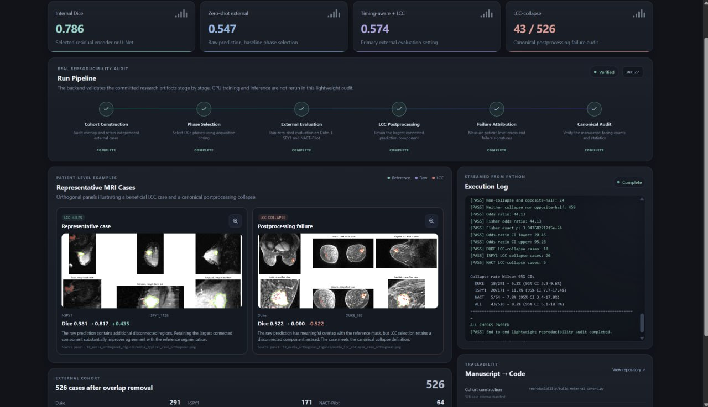

# Cross-Cohort Reliability and Failure Attribution in Breast DCE-MRI Tumor Segmentation

🎥 **Research demo & walkthrough:** [Watch the presentation on YouTube](https://youtu.be/MPAHwRVM4cQ)

[](https://youtu.be/MPAHwRVM4cQ)

This repository contains code, derived analysis artifacts, and an interactive reproducibility companion for the study:

**Cross-Cohort Reliability and Failure Attribution in AI-Based Breast DCE-MRI Tumor Segmentation**

The project focuses on leakage-controlled external validation, cross-cohort transportability, timing-aware DCE-MRI phase selection, postprocessing reliability, and patient-level failure attribution.

> **Research use only.** This repository and the interactive companion are not clinical software and are not intended for diagnosis, treatment, or clinical decision support.

## Interactive reproducibility companion

The repository includes a local web application that connects to a lightweight Python backend and streams the reproducibility audit into the browser in real time.

The live audit performs real checks against the committed study artifacts:

1. reconstructs the leakage-controlled external cohort from the source rosters;
2. checks the timing-aware phase-selection groups;
3. verifies overall and cohort-specific external Dice values;
4. verifies LCC postprocessing results;
5. recomputes the canonical LCC-collapse / opposite-image-half association;
6. runs the final manuscript-number verification.

The web interface shows the stage-by-stage pipeline, streamed Python logs, representative MRI cases, cohort counts, and manuscript-to-code traceability.

The lightweight audit **does not retrain the models or rerun GPU inference**. Those computationally intensive stages require the original imaging data, trained model artifacts, and the corresponding nnU-Net environment.

### Run the interactive companion locally

From the repository root, install the Python dependencies once:

```bash
python -m pip install -r reproducibility_backend/requirements.txt
```

Start the backend:

```bash
python -m reproducibility_backend
```

In a second terminal:

```bash
cd reproducibility_site
npm install
npm run dev
```

Then open the local address printed by Vite, normally:

```text
http://localhost:5173/
```

The interface should report **Python backend online**. Select **Run real audit** to execute the live reproducibility check and stream the Python output into the dashboard.

## Reviewer quick start

The core reviewer-facing checks can also be run directly from the command line without the web interface.

From the repository root:

```bash
python -m pip install -r reproducibility/requirements.txt
python reproducibility/build_external_cohort.py
python reproducibility/verify_paper_numbers.py
```

Or run the complete staged lightweight audit:

```bash
python reproducibility/run_live_audit.py
```

A successful run ends with:

```text
ALL CHECKS PASSED
[PASS] End-to-end lightweight reproducibility audit completed.
```

### Leakage-controlled external cohort

`reproducibility/build_external_cohort.py` independently reconstructs the external cohort by normalizing and comparing the MAMA-MIA I-SPY2 identifiers with the BreastDCEDL/I-SPY2 development roster.

It verifies:

- full MAMA-MIA cohort: **1,506**
- BreastDCEDL/I-SPY2 development roster: **982**
- matched MAMA-MIA I-SPY2-source cases excluded: **980**
- retained external cohort: **526**
- Duke: **291**
- I-SPY1: **171**
- NACT-Pilot: **64**

Generated audit copies are written to `reproducibility/_generated/` and are ignored by Git.

### Manuscript-number verification

`reproducibility/verify_paper_numbers.py` checks the principal external-validation and canonical LCC-failure values reported in the revised manuscript against the committed analysis outputs.

Key manuscript-facing values include:

| Result | Value |
|---|---:|
| Internal residual encoder nnU-Net Dice | 0.786 |
| Baseline external Dice, raw | 0.547 |
| Baseline external Dice, LCC | 0.569 |
| Timing-aware external Dice, raw | 0.555 |
| Timing-aware external Dice, LCC | 0.574 |
| LCC-collapse cases | 43 / 526 |
| Opposite-image-half flags | 54 / 526 |
| Collapse + opposite-image-half | 30 / 43 |
| Odds ratio | 44.13 |
| Fisher exact p-value | 3.948e-24 |

For exact values, cohort-specific results, confidence intervals, and artifact locations, see [`MANUSCRIPT_NUMBERS.md`](MANUSCRIPT_NUMBERS.md).

## Study-to-code map

| Study stage | Code / artifact | Purpose |
|---|---|---|
| Leakage-controlled cohort construction | `reproducibility/build_external_cohort.py` | Normalizes I-SPY2 identifiers, excludes matched MAMA-MIA I-SPY2-source cases, and verifies the 526-case external cohort |
| External phase selection / preprocessing | `06_external_validation/preprocess_mama_mia_nnunet_v2.py` | Timing-aware phase selection and five-channel external input construction |
| External evaluation | `06_external_validation/evaluate_external_validation.py` | Computes external segmentation metrics |
| Cohort / timing summaries | `06_external_validation/analyze_external_phase_subset_home.py` | Produces overall, cohort-specific, and timing-quality summaries |
| LCC postprocessing | `06_external_validation/postprocess_external_predictions.py` | Largest connected-component postprocessing |
| Failure attribution | `08_external_failure_attribution_analysis/run_08_failure_attribution_analysis.py` | Exploratory patient-level failure attribution |
| Canonical LCC-collapse audit | `15_final_lcc_collapse_profile/15b_canonical_lcc_flag_repair/run_15b_canonical_lcc_flag_repair.py` | Recomputes the final LCC-collapse and opposite-image-half flags from masks |
| Staged live reproducibility audit | `reproducibility/run_live_audit.py` | Runs the reviewer-facing checks stage by stage and emits progress markers and logs |
| Local reproducibility API | `reproducibility_backend/app.py` | Runs the fixed audit and streams its stdout to the web interface |
| Interactive companion | `reproducibility_site/` | Visualizes the pipeline, live logs, representative cases, cohort summary, and code traceability |
| Manuscript traceability | `MANUSCRIPT_NUMBERS.md` | Maps reported values to source scripts and canonical outputs |
| Lightweight verification | `reproducibility/verify_paper_numbers.py` | Checks the principal manuscript-facing external-analysis values |

## Canonical external-analysis outputs

The principal external summary files used for the revised manuscript are:

```text
external_manifest/external_phase_subset_summary_overall.csv
external_manifest/external_phase_subset_summary_by_cohort.csv
external_manifest/external_phase_subset_summary_by_overall_phase_quality.csv

15_final_lcc_collapse_profile/15b_canonical_lcc_flag_repair/
  article_takeaways_15b.txt
  metrics/canonical_all_case_lcc_opposite_audit.csv
  metrics/canonical_crosstab_lcc_collapse_vs_opposite_half.csv
```

### Historical versus canonical failure-audit outputs

Folders `13_final_lcc_side_audit`, `14_lcc_collapse_visual_pattern_review`, and the original files in `15_final_lcc_collapse_profile` document earlier exploratory audit stages and are retained for provenance.

**The revised manuscript uses the canonical results in `15_final_lcc_collapse_profile/15b_canonical_lcc_flag_repair/`.**

Canonical definitions:

- **LCC-collapse:** raw Dice > 0.20 and LCC Dice < 0.05.
- **Opposite-image-half flag:** ground-truth and LCC centroids lie on opposite image halves with x-axis separation >= 30 mm.

The 30-mm separation is an analysis parameter used for the spatial-displacement audit; it is not a clinically validated threshold.

## Representative MRI examples

The interactive companion displays the public orthogonal panels generated for two representative external-validation cases:

- **I-SPY1 / `ISPY1_1128`** — Raw Dice 0.381 → LCC Dice 0.817; an example in which LCC removes disconnected predictions and substantially improves overlap.
- **Duke / `DUKE_883`** — Raw Dice 0.522 → LCC Dice 0.000; a canonical LCC-collapse example.

The case-selection record is:

```text
12_media_orthogonal_figures/selected_cases_for_media_figure.csv
```

and the corresponding public figure panels are stored in:

```text
12_media_orthogonal_figures/
```

## Data access

Patient-level MRI data are not redistributed in this repository.

Users should obtain the original imaging datasets from their respective providers and comply with the corresponding access and attribution terms.

For MAMA-MIA downloads, `download_mama_mia.py` reads a Synapse personal access token from the environment variable `SYNAPSE_AUTH_TOKEN`; no credential is stored in source code.

PowerShell example:

```powershell
$env:SYNAPSE_AUTH_TOKEN="YOUR_TOKEN"
$env:MAMA_MIA_IMAGES_DIR="C:\path\to\mama_mia_images"
python download_mama_mia.py
```

Linux/macOS example:

```bash
export SYNAPSE_AUTH_TOKEN="YOUR_TOKEN"
export MAMA_MIA_IMAGES_DIR="/path/to/mama_mia_images"
python download_mama_mia.py
```

## Repository scope

The repository retains the analysis scripts and derived outputs needed to inspect the external-validation and failure-attribution workflow.

The lightweight reproducibility layer is intended to make the revised manuscript easier to audit:

- `reproducibility/` contains deterministic reviewer-facing checks;
- `reproducibility_backend/` provides the local Python streaming API;
- `reproducibility_site/` provides the interactive research companion;
- `MANUSCRIPT_NUMBERS.md` links manuscript-facing values to their exact source artifacts.

For the numerical provenance of the revised manuscript, use [`MANUSCRIPT_NUMBERS.md`](MANUSCRIPT_NUMBERS.md).
